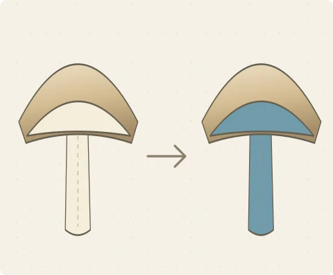
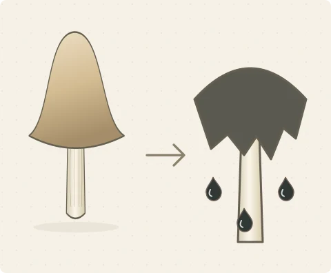
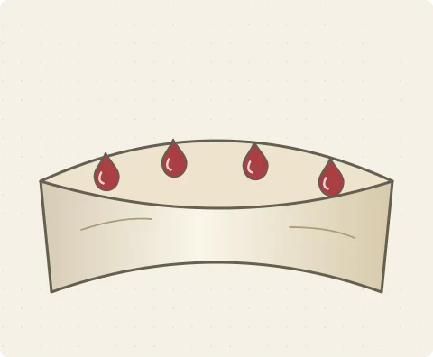
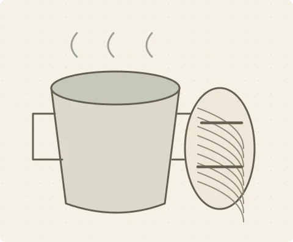

# Chapter 4 — Mycological characteristics: artwork and information

Status: implemented, verified, and approved by the user for commit.
Reviewed: 2026-10-24.

## Findings and visual approach

- The former inline glyphs were small, heavy, and visually repetitive. Larger
  labels also exposed empty areas in equal-height grid rows. The replacement is
  an original field-guide library: fine contours, gentle washes, light paper,
  and distinct anatomy, reaction, exudate, and use diagrams.
- **110 WebP schematics**, rendered at **480 × 396**, are generated from authored
  SVG geometry using the existing Sharp dependency. Original art source remains
  editable in `scripts/mycology-artwork.mjs`; the generated images live in
  `public/illustrations/mycology/`. No image-generation service or new dependency
  is needed. Images load individually and lazily, and repeat generation leaves
  identical files untouched. The complete library is **853.48 kB**;
  an individual profile uses a subset.
- Spore-print and spore-mass colours are now **plain filled circles**, with a thin
  outline and a text label. Absence/unknown states remain distinct.
- Cards flow down balanced columns in DOM reading order, with one column on
  narrow phones. Seasonality spans the panel width. Evidence remains a native,
  keyboard-operable disclosure. Larger raster artwork is supplementary to visible
  labels and the exact source text; images have empty alternative text to avoid
  repeating those labels.

## Artwork examples

| Blue staining | Inking | Guttation | Dye use |
| --- | --- | --- | --- |
|  |  |  |  |

These are concept illustrations. Extent, timing, colour qualifiers, and actual
specimen details come from the adjacent labels and original description.

## Source-backed coverage

| Presentation | Profiles with recorded/classified information |
| --- | ---: |
| Flesh reaction, including explicitly unchanging flesh | 89 (previously 83) |
| Maturation changes: blackening and/or inking | 7 |
| Droplets / exudates / latex / cut juice | 21 |
| Explicit natural dye use | 1 |
| Named seasons/months or year-round presence | 201 |

- Four recorded inking examples are Coprinellus micaceus, Coprinopsis
  atramentaria, Coprinopsis lagopus, and Coprinus comatus. Negated inking in
  Coprinellus disseminatus and Parasola plicatilis is not classified as inking.
  Hygrocybe conica's blackening is distinguished from Hygrocybe acutoconica's
  explicit non-blackening, and a host's decay is not attributed to its parasite.
- Exudate examples include Hydnellum peckii's blood-like droplets, Chamaemyces
  fracidus's orange droplets, Lactarius deliciosus's carrot-coloured latex,
  Mycena haematopus's blood-red cut liquid, Mycena sanguinolenta's reddish-purple
  sap, and Suillus granulatus's milky droplets. Close-up tissue diagrams also
  apply to brackets and mould colonies without implying a cap/central stipe.
  Microscopic oil droplets do not become macroscopic guttation.
- **Cortinarius sanguineus** explicitly records “Dye fungus, yields red and
  reddish-brown shades.” It receives the dye-bath/yarn illustration. The current
  latest Phaeolus schweinitzii profile has no explicit dye-use trait, so its common
  name is insufficient to add that claim. Additional dye facts need verified
  updates to the original latest captions, followed by regeneration.
- Supported cut/bruising descriptions in chemical-reaction rows now contribute
  flesh reactions; KOH/Guaiac-only colours do not. The `blueing` spelling and
  recorded violet/lilac staining are supported. Ordinary flesh colour, spore
  colour, and surface colour remain insufficient evidence of a flesh reaction.

## Seasonality precision

- Named seasons are displayed as seasons, without translating them to guessed
  months or assuming a hemisphere. Explicit month ranges use a twelve-month
  strip. Inclusive ranges can cross the end of the year; disjoint periods remain
  disjoint. Active segments have text, markers, and underlining as well as colour.
- Boletus edulis displays its summer/autumn record; Stropharia caerulea displays
  July–November. Qualifiers such as “late” remain readable in the evidence.
- “Visible year-round” is labelled **presence / persistence**, distinct from a
  claim of continuous fruiting. Encounter dates are not an input to the parser.
  Incidental winter road-salt habitat, unsupported spore-release/infection-cycle
  statements, and unrecognised period text do not supply an invented period.
- The recorded `novemeber - december` wording in Clitocybe phyllophila is not
  silently corrected into a precise calendar. Its original text remains visible;
  correcting that source requires author-verified caption curation.

## Data and source fidelity

All classifications come from the latest scientific profile. There is no genus
or species-name lookup for dye, reaction, or seasonal facts, and no older-profile
backfilling. Every new presentation retains supporting rows from that profile.

`npm run audit:characteristics -- --compare-head` compares the generated corpus
with the pre-change Git HEAD, ignoring only top-level derived characteristic keys.
It confirms **all other species fields are unchanged**, including scientific
profiles, caption strings, observations, photography data, dates, names, and photo
lists. The corpus remains **388 observations, 327 taxa, 1,641 photographs**.

Derived flesh-filter keys changed for six taxa:

- Asterophora lycoperdoides: explicit unchanging flesh from a reaction row.
- Gyrodon lividus, Hortiboletus rubellus, Imleria badia, Rubroboletus satanas:
  recorded cut/bruising blue reactions.
- Lactarius uvidus: recorded lilac/violet staining.

Those derived keys and the filter index were regenerated by the builder, including
the affected full-record JSON files. Source scientific text was not edited.
The existing twelve filter groups remain the gallery's filter schema; new dye,
exudate, maturation, and seasonality cards are profile presentations.

## Reproduction and verification

```sh
npm run content
npm run audit:characteristics
npm run audit:characteristics -- --details
npm run audit:characteristics -- --compare-head
npm test
npm run build
npm run audit:bundle
npm run test:ui
npm run build:encyclopedia
npm run audit:bundle
npx playwright test --config=playwright.subpath.config.js
npx playwright test --config=playwright.accessibility.config.js
```

- **89 Node tests passed**, including recorded reactions/negations, fluid colours,
  dye evidence, season/month ranges, non-fruiting references, source traceability,
  and known-artwork inventory.
- **47 main browser tests passed**: native evidence/keyboard opening, distinct
  decoded raster artwork, one-circle spore swatches, supported profile examples,
  and source-backed seasonal/monthly states, alongside existing behavior.
- **11 subpath tests passed**, including actual `/encyclopedia/illustrations/`
  image loading and colour-circle rendering.
- **12 accessibility tests passed**, including four additional axe page states
  for exudates, dye evidence, inking, and monthly seasonality. All audited states
  have zero axe violations. Keyboard opening/retained focus, text contrast,
  320 px text spacing, and non-colour forced-colour states are checked. Remaining
  incomplete findings/human screen-reader follow-ups retain the Chapter 2 scope.
- Root and `/encyclopedia/` builds and bundle audits passed. Largest JavaScript
  chunk remains **476.83 kB**, below the retained 500 kB warning budget.
- Artwork audit found all **110** declared raster assets and no missing files.
  Source comparison passed. `git diff --check` passed.
- Commit review grouped imports in the audit script/subpath suite; the source
  comparison and all 11 subpath tests passed again after this cleanup.
- Visually reviewed the complete artwork contact sheet and production screenshots
  of desktop Amanita, 320 px earthstar/monthly layouts, and mobile inking,
  guttation, and dye-use cards. Diagnostic screenshots remain in ignored outputs.

`dist/` is left configured for `/encyclopedia/`. The user approved Chapter 4 and
requested its Conventional Commit. Further chapters await explicit instruction.
